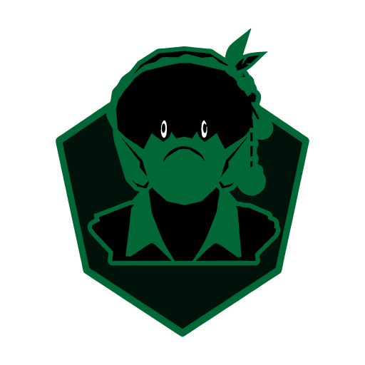

<h1 align="center">
  <br>
  HookyMod
</h1>

<p align="center"><strong>HookyMod is an experimental local toolkit for exploring user-supplied assets and preparing working copies.</strong></p>

<p align="center">
  <a href="#project-status">Status</a> ·
  <a href="#getting-started">Getting started</a> ·
  <a href="#features-and-limitations">Features</a> ·
  <a href="#command-line">Command line</a> ·
  <a href="#builds-and-tests">Builds and tests</a> ·
  <a href="#documentation">Documentation</a> ·
  <a href="#license-and-credits">License and credits</a>
</p>

**HookyCreator** is HookyMod's local visual workspace for exploring user-supplied models, textures, sounds, animations and WebM videos, editing working copies and making standard exports. A Python/Tk explorer and command-line tools are also available.

The source branch separates the experimental mod-maker from HookyCreator: its design workspace, mob sheets and mod assembly are no longer exposed by the app. Existing projects and files are not deleted. Historical source code is retained under [`modmaker/`](modmaker/README.md); it is not a standalone application. A separate source-only `.hooky` packaging tool remains available for already prepared files.

> [!IMPORTANT]
> No game, game assets, dictionaries, cryptographic keys or game executable are intentionally supplied. Bring your own files obtained lawfully and check your rights before using or sharing them. Tests use synthetic fixtures and do not require game files. No decryption capability or keys are supplied. The supplied project logo is kept at the maintainer's request; its origin and rights have not been verified.
>
> Working copies, exports and separately assembled mods can contain original or derivative material from your input files. Review the outputs and share them only when you have the necessary rights. The tool does not establish those rights or guarantee legal compliance.

HookyMod is an independent project, not affiliated with or endorsed by Team MagicBean or the authors of Hookshot.

[Longshot](https://git.magicbean.dev/MagicBeanDev/Longshot), maintained by Team MagicBean, is a separate fork of Hookshot. It is not a dependency of HookyMod. Direct integration with Longshot and compatibility of generated mods in that environment have **not** been verified.

## Project status

HookyMod 11.26.2 is a public release with experimental features. This source branch also contains **unreleased** skeleton and animation fixes and removes the mod-maker from HookyCreator; the published 11.26.2 installers do not include those changes and still contain the previous mod-maker. Format support is partial; a successful export, replacement or package does not guarantee visual accuracy or in-game compatibility. The Linux, Windows and macOS installers are unsigned, and macOS notarization and interactive window testing remain unverified. Check the rights and dependency notices before distributing any binary.

| Area | Current support and limits |
| --- | --- |
| Local workspace | Browse and filter assets, maintain a per-project session, and work on copies. Some diagnostics and native-window messages remain in French. |
| Separated source tools | Historical design-project code and an experimental `.hooky` packager remain in the source tree, outside the app. No generator from blocks or direct launcher integration is implemented or validated. |
| Models | Inspect and export GLB / glTF / OBJ with available textures. Geometry injection is restricted to some BFRES 9.x targets; BFRES 10.x injection, rig injection and morphs are not supported. |
| Textures | Preview, export PNG and replace supported BNTX images. ASTC and BC7 encoding is not available. |
| Animations | Preview supported BFRES 10.x FSKA Euler, quaternion and mixed clips, export curves as JSON, or experimentally export clips with their skin: one selected clip in GLB/glTF, or detected clips together in one GLB. OBJ/MTL and batch exports are static; animation injection is not supported. |
| Collections and Player | Find name-based model/outfit suggestions for an animation and temporarily compose a character with separately skinned outfits or bone-attached items. These are experimental previews, not validated in-game assemblies or exports. |
| Audio and video | Experimental BWAV conversion and replacement, plus WebM preview and replacement. Game compatibility is not validated. |
| Desktop | CI targets Tauri and a standalone backend on Windows, Linux and macOS. Packages are experimental; the macOS window has not been tested interactively. |

## Getting started

### What you need

- Python 3.10 or newer and the packages in `requirements.txt` for the browser workspace.
- Your own legally obtained extracted assets, including any required zstd dictionary, for HookyCreator's asset tools. Automated tests use synthetic fixtures and do not require game files.
- A WebGL2-capable browser for the interactive model view; a static PNG fallback is available.
- Optionally, Tkinter for the original explorer. To build the native window, see [desktop prerequisites](docs/DESKTOP.md).

### Start the workspace from source

From the project source directory:

```bash
python -m pip install -r requirements.txt
python -m hookycreator /path/to/romfs --host 127.0.0.1 --open
```

The workspace opens at `http://127.0.0.1:8765/` and listens only on loopback by default. The browser server checks the local host and cross-origin API requests; write actions require JSON POSTs. Scripts using the old GET write routes must switch to POST. An explicitly chosen non-local `--host` exposes an **unauthenticated** server and allows the workspace page to be embedded by another site for proxy previews: do not use it on an untrusted network. A folder of extracted assets can be used instead of a `romfs`. Add `--work /path/to/work` to choose where working copies and caches are stored.

The original explorer is available with `python AssetViewer.py`. For the native Tauri window and standalone backend, follow [docs/DESKTOP.md](docs/DESKTOP.md). These builds are not necessarily signed; platform security warnings can appear.

## Features and limitations

### Separated mod-maker sources

The current HookyCreator app has no design workspace, mob records or mod-build action. Older `hookycreator_work/hookymods/` projects, `hookycreator_work/mobs/` records and existing `mods/` folders remain untouched. Old sessions are restored to Home when their former view no longer exists; other supported filters, tabs and import choices are retained. Before the first new checkpoint, a byte-for-byte backup of a session containing retired maker data is saved under `sessions/*.pre-modmaker-*.json.bak`; if that backup fails, the original session is not replaced.

The prototype's Python code and non-standalone historical interface are kept under [`modmaker/`](modmaker/README.md) for future separation. The archived assembly code is not exposed in the app; if invoked directly it **deletes an existing `mods/<name>` folder without a backup**. The standalone source-only packager can still handle already prepared files via `python -m modmaker.modpackage`; the historical `python -m hookycreator.modpackage` entry point remains as a compatibility alias. Neither tool generates game content or guarantees compatibility. The published 11.26.2 release predates this separation. See the [historical maker notes](docs/HOOKYMODS.md) and [launcher format contract](docs/HOOKY_FORMAT_EN.md).

### Models: export and return

1. In **Edit → Models**, open a model in the interactive 3D view. Decoded triangles are not reduced for display; oversized models may be refused by safety limits. Drag to orbit, use the wheel to zoom, and optionally enable wireframe or experimental FSR 1.
2. To download a **single GLB containing the detected clips**, choose **Download 1 GLB · all detected animations** on the model card. It considers every file suggested by the name heuristic (not just the first 32 displayed) and also the selected preview file, if any. Associations can be wrong or miss files; to add an unrecognized file, open it from Animations and choose the model. Identical decoded clips with the same name are grouped; different clips with the same name remain separate. Unsupported clips/files and missing tracks make the result explicitly partial, with details in the result panel and `RAPPORT_ANIMATIONS.txt` in the export folder. If none can be exported, no GLB is produced. Global size and sample limits stop the export rather than silently truncate it.
3. Alternatively, select one preview clip and choose **Export GLB / glTF / OBJ**. That ZIP contains a self-contained `.glb`, glTF 2.0 (`.gltf` + `.bin`), OBJ/MTL, available PNGs, a notice and a report. An accepted clip and skin go into GLB/glTF only; OBJ/MTL cannot store animations. Without a clip, and in selection or batch exports, all formats are static. Re-exporting replaces same-named files: save edits elsewhere.
4. In Blender use **File → Import → glTF 2.0** for the standalone GLB or the glTF with its adjacent `.bin` and PNGs. For Wavefront import the OBJ with its MTL and PNGs beside it. Recognized material references are resolved per material; missing or ambiguous references are reported, and textures are not linked in glTF without UVs. Some BFRES 10.x rigid pieces use their rest pose. Skin and animation export are experimental, limited to supported skeletons and Euler/quaternion curves at a conventional 30 fps; unsupported variants are refused. Only synthetic animations have been verified in Blender. Morphs, shaders and other LODs are not reconstructed.
5. After editing, choose **Import a model** and analyze a triangulated OBJ, GLB or glTF 2.0 with its external `.bin` files. Only geometry is imported; the target's materials and textures are retained.
6. Injection writes a copy under `hookycreator_work/assets/`, not the original. It accepts only one shape and one LOD in certain BFRES 9.x structures, within existing buffer capacity. BFRES 10.x targets, skeletons, morphs, bounds requiring rewriting and unverified structures are refused. A successful re-read does not prove in-game safety.

Provided UVs and normals must be representable by the target. Missing normals are not invented in exports, although a preview may compute face normals. OBJ polygons must be triangulated. Required glTF extensions, compressed buffers, deformations, sparse accessors and network access are not supported. See the [workspace guide](docs/HOOKYCREATOR.md).

### Player and 3D performance

In **Collections**, search for an animation to see candidate models and outfits suggested by their names. Open a character as the base in **Player**, then manually select up to five outfit or item slots and test a supported clip. Outfits use their own skeletons; objects can be attached to a chosen base bone with adjustable transforms. Player can follow a unique root with the camera so large motion stays in frame; turn this off to inspect global movement. Names and age labels are only hints, and **All project models** allows manual selection. Required files can be missed, incompatible outfits are reported, and no game assets are supplied. The composition is temporary, retained between views in the open session but not saved after reload and not included in exports. Real Link models, equipment and animations have not been validated in game. See the [workspace guide](docs/HOOKYCREATOR.md#ensembles-et-player--essayer-une-composition).

**Settings → 3D view & animations** offers native rendering or adjustable experimental **FSR 1**, with per-dimension scene scales of 77%, 67%, 59% and 50%, sharpening, FSR MSAA, pixel-density and canvas caps, and a 15/30/60 fps animation cap. FSR 1 is spatial upscaling, not FSR 4; it does not reduce triangle count or affect PNGs or exports and can be slower on some GPUs. Compare settings on your own hardware.

### Animations, sounds and video

- **Animations:** supported FSKA Euler, quaternion and mixed skeletal clips are matched by bone name to a compatible structured model. Each exported clip is present once, without repeating its cycle; in the combined GLB, clips share one skeleton and can be selected separately in a compatible reader (e.g. Blender actions; mute NLA tracks to play an action alone). Channels used by other clips are reset to the rest pose when absent. Keys at the same frame may encode a jump; glTF requires distinct times, so such jumps are approximated by a short transition and reported. Very close keys may be merged by some importers. Playback uses 30 frames per second by convention, not a verified game rate. The viewer retains up to eight skin influences and stops safely if an animated pose becomes singular. Maya segment scale compensation is previewed. For compensation declared in the skeleton, glTF export supports constant, nonzero parent scales (including nonuniform scales) using helper nodes; when it is declared only in the clip, the parent scale must also be uniform. Variable parent scales remain unsupported. Billboards, Softimage scale mode and unsupported curves are refused or explicitly listed as omissions. Physics, materials and full game fidelity are not reproduced.
- **Sounds:** the BWAV reader supports complete PCM16 or DSP-ADPCM mono/stereo and the existing mono Opus variant. It exports WAV, FLAC, MP3 and Ogg Vorbis, or remuxes supported Opus. Loop markers are not retained. Replacement must match the original sample rate and channel count and produces an experimental PCM16 working copy. BARS, prefetch audio, other layouts, events and RESTBL are not rewritten.
- **Video:** WebM can be previewed when the browser supports its codec, downloaded or copied verbatim as a replacement. The check covers only the EBML header, WebM DocType and Segment bounds, not tracks, codecs, duration, resolution or game compatibility. Streaming is limited to 1 GiB and replacement input to 32 MiB. NDVE, separate audio and RESTBL are not updated.

### Other tools

- **Textures:** preview and export BNTX PNGs; replace an image in a working copy for encodable formats. Some decoders require `texture2ddecoder`.
- **Archives:** inspect, extract and rebuild SARC and `.zs` files using user-supplied zstd dictionaries. Missing dictionaries and incomplete data are reported.
- **Session:** navigation, filters, selection, inspector and drafts are saved per project. Working copies and settings are separate from the session; an abrupt shutdown can lose the last save. See [session recovery](docs/PERFORMANCE.md).
- **Languages and themes:** French, English, Russian and Chinese UI translations, plus light, dark and Aurora themes. Translation coverage is partial.

## Command line

```bash
# Diagnostics and inspection
python -m hookymod.cli doctor /path/to/romfs
python -m hookymod.cli scan /path/to/romfs
python -m hookymod.cli list archive.pack.zs --recursive

# Static model export; --formats glb, --formats gltf or --formats obj selects one format
python -m hookymod.cli export-model model.bfres -o model_export
python -m hookymod.cli export-model model.bfres -o model_export --no-textures

# Editable PNG / OBJ project and conservative rebuilding
python -m hookymod.cli translate unpack --romfs /path/to/romfs -p project
python -m hookymod.cli translate status -p project
python -m hookymod.cli translate pack -p project -o mods --mod-name MyMod

# Batch export with a report of errors and limitations
python -m hookycreator export-all /path/to/romfs -o export_all
```

The translation project's `origin/` folder retains source files as templates; `translate pack --all` also copies unchanged originals. Review the project, exports and assembled mod before sharing them.

The `export-model` CLI searches neighboring textures by name and links only an unambiguous single albedo to a single material; this remains heuristic. Multi-image BNTX files and ambiguous output names are skipped and reported. OBJ input retains per-corner UV and normal indices, but source MTL libraries and textures are not imported. Nonzero LOD requests for prebuilt BFRES 10.x are refused. Choose a dedicated output folder: files with the same names may be replaced. In the Tk explorer, glTF/OBJ export does not automatically link textures. Check `--help` for the supported options.

The default scan limit is 200,000 recognized files. Incomplete scans and unreadable entries are reported; `--scan-limit 0` removes the limit but may use more memory.

## Builds and tests

```bash
python -m pip install -r requirements.txt pytest pytest-subtests pillow
python -m pytest -q
# JavaScript UI tests, without additional npm dependencies
for f in tests/*_test.js; do node "$f" || break; done
```

Format tests use synthetic fixtures. A software-browser WebGL2 / FSR smoke test is described in [docs/PERFORMANCE.md](docs/PERFORMANCE.md). Blender interoperability is tested optionally as a glTF/OBJ consumer. [docs/DESKTOP.md](docs/DESKTOP.md) covers native builds and tests; the [Rust core](docs/RUST.md) accelerates some operations but does not replace the Python application.

### Troubleshooting

- **Files are missing:** check the selected folder, read permissions, scan-limit warnings and any required user-supplied zstd dictionary.
- **A texture or model cannot be exported or reimported:** the format or target may be unsupported; inspect the report rather than assuming the output is complete.
- **A rebuilt mod does not work:** review its target loader's instructions, RESTBL requirements and the limitations above. HookyMod does not validate the result in a game.
- **A native build fails:** check the platform prerequisites and diagnostics in [docs/DESKTOP.md](docs/DESKTOP.md). Do not attach game files or keys when reporting an issue.

## Documentation

- [Separated mod-maker sources and historical design projects](docs/HOOKYMODS.md)
- [`.hooky` project and experimental mod package contract for launchers](docs/HOOKY_FORMAT_EN.md) ([French reference](docs/HOOKY_FORMAT.md))
- [Workspace, formats and limitations](docs/HOOKYCREATOR.md)
- [Native window and build](docs/DESKTOP.md)
- [Session recovery and performance](docs/PERFORMANCE.md)
- [Asset inspection and dictionaries](docs/OUVRIR_LES_ASSETS.md)
- [NUP, translation and mod folders](docs/HOOKSHOT.md)
- [Provenance, references and third-party dependencies](docs/PROVENANCE.md)
- [Publication checklist](docs/PUBLICATION.md)

## License and credits

Project-authored material offered under the [HookyMod Noncommercial License 1.0](LICENSE) may be used, modified and shared for noncommercial purposes. Sale and commercial use or distribution are not permitted, including for modified versions. Genuine voluntary donations with no benefits in return remain possible. The project is **source-available**, not open source as defined by the Open Source Initiative.

Third-party components retain their own licenses and notices, and prior rights validly granted under other terms are not revoked. The license text governs this summary. See [THIRD_PARTY_NOTICES.md](THIRD_PARTY_NOTICES.md) and [PROVENANCE.md](docs/PROVENANCE.md) for credits, format references and the limits of the dependency audit. Hookshot's public format notes were consulted; no Hookshot or Longshot source code was intentionally incorporated during this work. The provenance of the complete codebase remains to be reviewed.

## Support the project

Voluntary donations with no goods, services, access or other benefits in return are welcome but never required to obtain or use the software.


Solana address: `y8eeEqNTo7pANwRVvwsrNDu9gpPTFYW5FrP2oMUtfhZ`.

polygon adress:
`0xb7b8ed7b3d86ccf0ff0b0239b1a01584a85c12c6`.